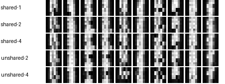

# Recurrent diffusion under a fixed budget



`python run.py demo` runs a three-update CPU smoke test for all five models. Install the prerequisites with `python -m pip install -r requirements.txt`.

## Question and scope

What changes when a small generator reuses its middle transformer block at inference? This repo runs the actual upstream Looped-DiT denoiser, flow-matching loss and Euler sampler on scikit-learn's bundled 8×8 UCI optical digits. Digit labels are ten one-hot conditions. The experiment measures small class-conditioned generators; full text-to-image training would require a different budget.

## Reproduce

```shell
python -m unittest discover -s tests
python run.py demo
python run.py reproduce
python run.py evaluate
```

The formal config trains each model from a seeded initialization for 120 AdamW updates on the same sequence of mini-batches (16 digits per update). There are 1,437 training and 360 held-out examples. A fixed 120-example subset of the held-out split is scored using identical noise, t = 0.5 and mean pixel reconstruction error. Lower is better. Evaluation reloads each saved model before saving predictions, then regenerates the table directly from those predictions and dataset IDs. The default formal run writes to `results/`. Use `--out another-directory` to preserve the shipped result.

| Shared middle block | Loops | Parameters | Block calls per denoiser | Held-out MSE |
|---|---:|---:|---:|---:|
| Yes | 1 | 64,390 | 3 | 0.23528 |
| Yes | 2 | 64,390 | 4 | 0.23797 |
| Yes | 4 | 64,390 | 6 | 0.23783 |
| No | 2 | 82,214 | 4 | 0.22242 |
| No | 4 | 117,862 | 6 | 0.22421 |

The three shared configurations have identical parameter counts. At loop depths two and four, the unshared controls execute the same sequence of tensor operators with the same shapes, using a separate parameter tensor per middle block. Equal-depth pairs therefore match forward inference arithmetic. The reported counts describe block calls, not measured wall-clock speed. The unshared controls obtained lower held-out MSE at these two budgets. Repeated use of the trained shared block did not improve held-out MSE on this seed and scale. The rows in the image follow the table order; each column requests the same digit with identical initial noise across rows. The single-seed, 120-update result is a local ablation, and sample legibility is limited.

## Code and data

- `src/looped_dit/` contains the two unchanged upstream files and their original MIT license.
- `run.py` contains this repo's CPU experiment, deterministic splits, equal-budget controls, checkpoint/reload checks, metrics and comparison image.
- `configs/experiment.json` fixes the seed and training budget. `results/` contains all five weights, predictions, generated samples and the measured CSV.
- Use `HANDOFF.md` to continue the work. Versions, licenses and source files are recorded in `UPSTREAM.md`.

[Upstream Looped-DiT](https://github.com/OpenSenseNova/Looped-DiT) · [Digit data provenance and license](https://archive.ics.uci.edu/dataset/80/optical+recognition+of+handwritten+digits)
